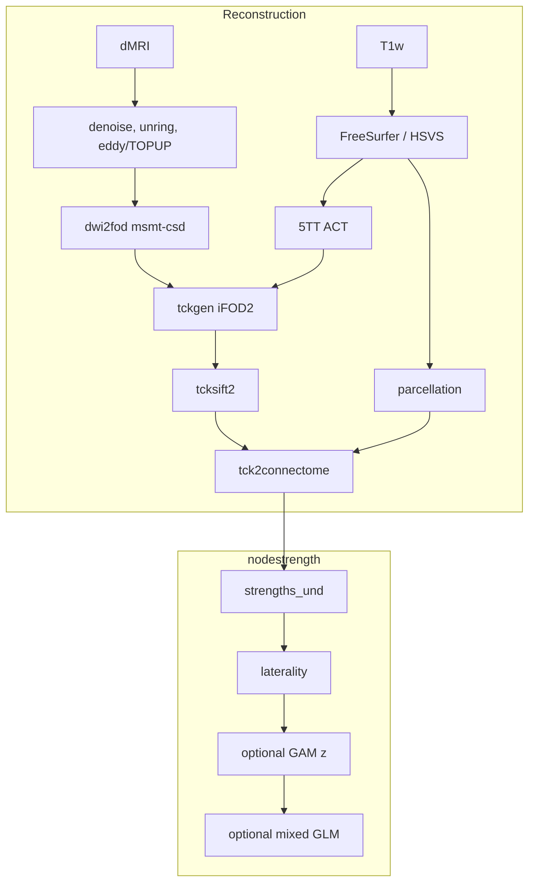

# Pipeline details

Two layers: **reconstruction** (optional container / QSIRecon) and **analysis** (this package).

## Reconstruction (Piper-aligned)

Piper et al. 2026 used MRtrix3 multi-shell multi-tissue CSD, anatomically constrained tractography (ACT), and SIFT2. Canonical citations:

- MRtrix3 framework — Tournier et al. 2019[^tournier2019]
- MSMT-CSD — Jeurissen et al. 2014[^jeurissen2014]
- ACT — Smith et al. 2012[^smith2012act]
- SIFT2 — Smith et al. 2015[^smith2015]
- QSIPrep preprocessing — Cieslak et al. 2021[^cieslak2021]

Default `tckgen` in the container: iFOD2, \(10^7\) streamlines (lab-configurable), ACT 5TT, backtrack. SIFT2 writes a per-streamline weight; `tck2connectome -tck_weights_in` sums weights between parcels.

!!! warning "Deterministic vs probabilistic"
    `tckgen` with `Tensor_Det` / FACT is **not** the same graph as iFOD2. Mixing them in one ROC table is a data error, not a statistics error. See [Connectomics](science/connectomics.md).

## Analysis mathematics

For undirected weighted adjacency \(W\):

\[
s_i = \sum_{j \neq i} \frac{w_{ij} + w_{ji}}{2}
\]

This is BCT `strengths_und`[^rubinov2010]. Asymmetry for a homologous pair:

\[
\mathrm{AI} = \frac{s_L - s_R}{s_L + s_R}
\]

Intrahemispheric strength zeroes edges that cross the midline before the sum. Volume AI substitutes parcel volume for \(s\).

Normative z-scores: residual of \(s_i\) after a GAM on controls (age, sex, motion, global strength), divided by control residual SD (Piper et al. 2026).

## Lausanne 2008 lookup tables (IDEAS)

Connectome **row order** is not FreeSurfer LUT order. Independent extraction from easy_lausanne GraphML (Cammoun et al. 2012[^cammoun2012]) yields:

| Scale | Nodes (no brainstem) | Hippocampus indices (L, R) |
|---|---|---|
| 36 | 82 | 5, 12 |
| 60 | 128 | 5, 12 |
| 125 | 233 | 5, 12 |
| 250 | 462 | 5, 12 |

Order: drop `Brain-Stem`, then left subcortical, right subcortical, left DK cortex (split at finer scales), right DK cortex. Hippocampus remains a **single node per hemisphere** at every Lausanne 2008 scale.

If you use someone else’s CSV “LUT”, re-extract it. Matching node counts is not matching order.

## What this pipeline does not do

- Functional connectivity (Pearson/partial correlation, tangent space)
- Network-based statistic (NBS) edgewise inference
- Community detection / rich-club / graph spectra
- Tractometry along bundles (AFQ, TractSeg)

Those are neighbouring methods; see [Other connectomic methods](science/other-methods.md) and [Graph theory beyond this tool](science/beyond.md).

[^tournier2019]: Tournier J-D et al. *NeuroImage* 2019;202:116137.
[^jeurissen2014]: Jeurissen B et al. *NeuroImage* 2014;103:411–426.
[^smith2012act]: Smith RE et al. *NeuroImage* 2012;62:1924–1938.
[^smith2015]: Smith RE et al. *NeuroImage* 2015;119:338–351.
[^cieslak2021]: Cieslak M et al. *Nat Methods* 2021;18:775–778.
[^rubinov2010]: Rubinov M, Sporns O. *NeuroImage* 2010;52:1059–1069.
[^cammoun2012]: Cammoun L et al. *J Neurosci Methods* 2012;203:386–397.
