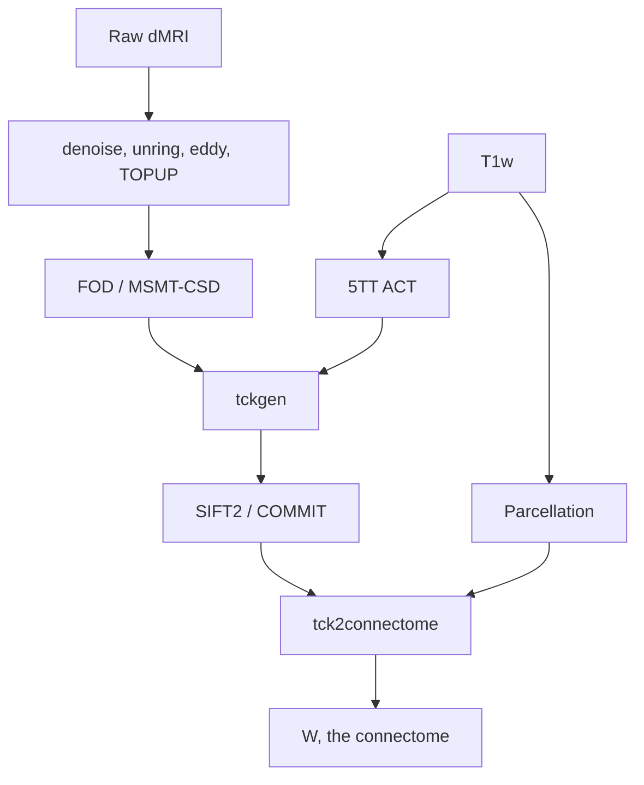

# Connectomics

**Connectomics** is the project of mapping neural connections at a chosen scale (Sporns, Tononi & Kötter 2005[^sporns2005]; Lichtman & Sanes 2008 at microscale; Hagmann 2008 and the Human Connectome Project at macroscale[^hagmann2008][^vanessen2013]).

This tool lives at **macroscale, in vivo, diffusion MRI**. The matrix \(W\) that `nodestrength` consumes is not “the connectome” in the synaptic sense. It is a reconstruction. This page is how that reconstruction is made, why two labs’ \(W\) disagree, and which literatures sit next to it.

## Scales of connectomics (do not mix them)

| Scale | Object | Methods | Landmark |
|---|---|---|---|
| Micro | Synapses, neurites | EM (White 1986 *C. elegans*; FlyEM; MICrONS) | Lichtman & Sanes 2008 |
| Meso | Projection neurons, tracers | Viral tracers, CLARITY, CoCoMac, Allen CCFv3 | Markov et al. macaque; Oh et al. mouse |
| Macro | Grey-matter parcels, white-matter pathways | dMRI tractography, polarised light, dissection | Hagmann 2008; HCP |

Jones, Knösche & Turner (2013)[^jones2013] is the paper to read before treating a streamline count as an axon count.

## How a structural connectome is made

1. **Preprocess** the diffusion data (motion, eddy, susceptibility). [QSIPrep](https://qsiprep.readthedocs.io/) (Cieslak et al. 2021[^cieslak2021]) is the current standard BIDS implementation.
2. **Estimate fibre orientations.** DTI (Basser, Mattiello & LeBihan 1994) gives one ellipsoid per voxel — insufficient at crossings. HARDI / CSD (Tournier, Calamante & Connelly 2007) and **MSMT-CSD** (Jeurissen et al. 2014[^jeurissen2014]) give fibre orientation distributions (FODs) that can support multiple peaks.
3. **Grow streamlines.** Deterministic: follow the peak (FACT, SD_STREAM). Probabilistic: sample the FOD (iFOD2 in MRtrix3). Anatomically constrained tractography (ACT; Smith et al. 2012[^smith2012]) uses a 5-tissue-type image so streamlines terminate in grey matter rather than running into CSF.
4. **Filter.** Raw tractograms over-represent easy paths. **SIFT** (Smith 2013[^smith2013]) removes streamlines; **SIFT2** (Smith 2015[^smith2015]) keeps them all and assigns a weight so the FOD is explained. **COMMIT** (Daducci 2015[^daducci2015]) and LiFE (Pestilli 2014) are convex / biological alternatives.
5. **Parcellate and count.** `tck2connectome` sums (weighted) streamlines between pairs of grey-matter labels.

MRtrix3 (Tournier et al. 2019[^tournier2019]) is the usual implementation of 2–5. QSIRecon wraps those recipes in BIDS.

### Deterministic vs probabilistic

| | Deterministic | Probabilistic (iFOD2) |
|---|---|---|
| Algorithm | Follow the FOD peak | Sample the FOD |
| Typical \(W\) | Sparser; weaker long-range | Denser; more long-range |
| False negatives | Kissing / crossing missed | Fewer misses |
| False positives | Fewer hallucinations | Long-range invented connections |
| Strength / AI | Different numbers on the same subject | Different numbers on the same subject |

They are **different experiments**. A bitwise-identical Count matrix labelled both “det” and “prob” is a **packaging error**, not a replication. True deterministic Count on the same subjects is sparser and will move ROC AUC. IDEAS Figshare dumps have illustrated both the error (old “det” copied from prob) and the real difference (later true det zip).

### What tractography cannot promise

Read these before writing “we mapped the connectome”:

- Jones, Knösche & Turner 2013 — fibre count and other fallacies[^jones2013]
- Thomas et al. 2014, *PNAS* — anatomical accuracy is inherently limited[^thomas2014]
- Maier-Hein et al. 2017 — international tractography challenge; even experts disagree[^maierhein2017]
- Schilling et al. 2019 — modern methods still limited[^schilling2019]
- Yeh et al. 2021 — challenges and opportunities review[^yeh2021]
- Reveley / Jbabdi / Calabrese — gyral bias, bottleneck issues, ground-truth animal comparisons

A zero in \(W\) means “this reconstruction did not draw a connection,” not “biology has no axons here.” A large \(w_{ij}\) means “many weighted streamlines ran between these parcels,” not “this is a strong synaptic projection.”

## Edge weights are different graphs

On the **same** tractogram you can write several matrices. They are not interchangeable biomarkers.

| Weight | How it is made | What \(s_i=\sum_j w_{ij}\) then means |
|---|---|---|
| Count | Number of streamlines | Raw reconstructed wiring mass; scales with `tckgen` count |
| SIFT2-weighted count | Streamline weights from SIFT2 | Preferred quantitative structural edge (Smith 2015) |
| CountScaled | Count ÷ (volume and/or length) | Attempts to correct parcel size; **name the divisor** |
| Mean FA | Average FA of voxels / streamlines on the path | Mixes *whether* a path exists with *microstructure* of that path |
| MD / RD / AD | Same with other tensors | Diffusivity load, not wiring mass |
| Mean length | Average streamline length | Total millimetres of track, not connection weight |

Gong et al. (2009)[^gong2009] and Hagmann (2008) discuss weighted vs binary cortical networks. **Never** concatenate Count AI and MeanFA AI in one ROC without labelling the edge. In IDEAS-style trees you will see `Count`, `CountScaled`, `MeanFA`, `MD`, `Length` as separate experiments.

## Parcellations used with this software

### Desikan–Killiany and `fs_default`

Desikan et al. (2006)[^desikan2006]: 34 cortical gyri per hemisphere from FreeSurfer `aparc`, plus subcortical `aseg` structures. MRtrix3 `fs_default.txt` is an 84-row lookup used by `labelconvert`. `dkt-ai-cohort` pairs homologous L/R labels on that grid. **Thalamus is one node per side** (`Thalamus-Proper`). Per-nucleus thalamus requires THOMAS (or similar) on top — that is the Piper atlas, not DK.

### Lausanne 2008 / Cammoun

Hagmann 2008 and Cammoun et al. 2012[^cammoun2012]: recursive subdivision of DK cortex. Published scales are approximately 36, 60, 125, 250 *cortical* parcels per hemisphere-style naming; after dropping brainstem and using both hemispheres plus subcortex, connectome sizes in easy_lausanne GraphML (this project) are **82 / 128 / 233 / 462** nodes. **Hippocampus is not split.** Row order is GraphML order: drop `Brain-Stem`, then left subcortical, right subcortical, left cortex, right cortex — **not** `FreeSurferColorLUT.txt` order. Matching node counts is not matching LUT.

### THOMAS thalamic nuclei

Su et al., Thalamus Optimized Multi Atlas Segmentation[^su2019]. Piper et al. 2026 merge THOMAS nuclei with cortical Lausanne/DK-style labels to ask *which nucleus* is under-connected[^piper2026]. Whole-thalamus DK AI cannot answer that.

### Other atlases you will meet

AAL (Tzourio-Mazoyer 2002), Harvard-Oxford, Schaefer 2018[^schaefer2018], Glasser MMP 2016[^glasser2016], Brainnetome (Fan 2016), AICHA, Yeo 7/17 (functional, not structural). Zalesky 2010: node choice changes every subsequent metric.

## Functional connectomics (not computed here)

Resting-state edges are typically Pearson or partial correlations of ROI time series (Biswal 1995; Smith et al. 2011[^smith2011]). Confounds: motion (Power et al. 2012[^power2011]), global signal, atlas, pipeline (Ciric / Parkes “denoising” papers). Graph metrics can be computed on that matrix; thresholding and density are a literature of their own (van Wijk 2010[^vanwijk2010]). **NBS** (Zalesky, Fornito & Bullmore 2010[^zalesky2010nbs]) is the standard edgewise inference tool — see [Other methods](other-methods.md).

Do not run `strengths_und` on a Fisher-z matrix and interpret it as streamline strength.

## Epilepsy and the connectome

Focal epilepsy is a **network** disease as much as a focal lesion (Spencer 2002; Richardson 2012; Bernhardt, Bonilha & Gross 2015[^bernhardt2015]; Tavakol et al. 2019). Relevant strands:

- **Hippocampal sclerosis:** volume loss and T2; laterality of volume is the classical MRI biomarker. Connectivity AI asks whether remaining tissue is also under-wired ([Asymmetry](asymmetry.md)).
- **Thalamocortical loops:** absence and focal seizures both implicate thalamus; Piper et al. 2026 measure **thalamocortical structural strength** in children with focal epilepsy, with SOZ and mixed-design GLM[^piper2026].
- **Graph metrics in epilepsy:** reviews report altered clustering, efficiency, and hubs — with all the density caveats of the primer. This software does not add those metrics by default.
- **IDEAS I/II:** Lausanne-scale structural connectomes used in this repository to apply strength+AI to hippocampus (Count/FA/Length, det vs prob, scales 36–250).

## Practical checklist before you score \(W\)

1. Named reconstruction (QSIPrep version, MRtrix3 version, iFOD2 vs FACT, SIFT2 on/off, streamline count).
2. Named atlas, scale, LUT provenance.
3. One weight type per contrast.
4. Det and prob never pooled unlabeled.
5. Diagonal zeroed, matrix square, symmetrised if undirected.
6. Then — and only then — [node strength](strength.md).

[^sporns2005]: Sporns O, Tononi G, Kötter R. *PLoS Comput Biol*. 2005;1:e42.
[^hagmann2008]: Hagmann P et al. *PLoS Biol*. 2008;6:e159.
[^vanessen2013]: Van Essen DC et al. *NeuroImage*. 2013;80:62–79.
[^jones2013]: Jones DK, Knösche TR, Turner R. White matter integrity, fiber count, and other fallacies. *NeuroImage*. 2013;73:239–254.
[^cieslak2021]: Cieslak M et al. *Nat Methods*. 2021;18:775–778.
[^jeurissen2014]: Jeurissen B et al. *NeuroImage*. 2014;103:411–426.
[^smith2012]: Smith RE et al. Anatomically-constrained tractography. *NeuroImage*. 2012;62:1924–1938.
[^smith2013]: Smith RE et al. SIFT. *NeuroImage*. 2013;67:298–312.
[^smith2015]: Smith RE et al. SIFT2. *NeuroImage*. 2015;119:338–351.
[^daducci2015]: Daducci A et al. COMMIT. *IEEE TMI*. 2015;34:246–261.
[^tournier2019]: Tournier J-D et al. *NeuroImage*. 2019;202:116137.
[^thomas2014]: Thomas C et al. *PNAS*. 2014;111:16574–16579.
[^maierhein2017]: Maier-Hein KH et al. *Nat Commun*. 2017;8:1349.
[^schilling2019]: Schilling KG et al. *NeuroImage*. 2019;185:1–11.
[^yeh2021]: Yeh C-H et al. *J Magn Reson Imaging*. 2021;53:1666–1682.
[^gong2009]: Gong G et al. *Cereb Cortex*. 2009;19:524–536.
[^desikan2006]: Desikan RS et al. *NeuroImage*. 2006;31:968–980.
[^cammoun2012]: Cammoun L et al. *J Neurosci Methods*. 2012;203:386–397.
[^su2019]: Su JH et al. THOMAS. *NeuroImage*. 2019.
[^piper2026]: Piper RJ et al. *Epilepsia*. 2026;67:1901–1915.
[^schaefer2018]: Schaefer A et al. *Cereb Cortex*. 2018;28:3095–3114.
[^glasser2016]: Glasser MF et al. *Nature*. 2016;536:171–178.
[^smith2011]: Smith SM et al. *NeuroImage*. 2011;54:875–891.
[^power2011]: Power JD et al. *NeuroImage*. 2012;59:2142–2154.
[^vanwijk2010]: van Wijk BCM, Stam CJ, Daffertshofer A. *PLoS One*. 2010;5:e13701.
[^zalesky2010nbs]: Zalesky A, Fornito A, Bullmore ET. *NeuroImage*. 2010;53:1197–1207.
[^bernhardt2015]: Bernhardt BC, Bonilha L, Gross DW. *Epilepsia*. 2015;56:1837–1846.
