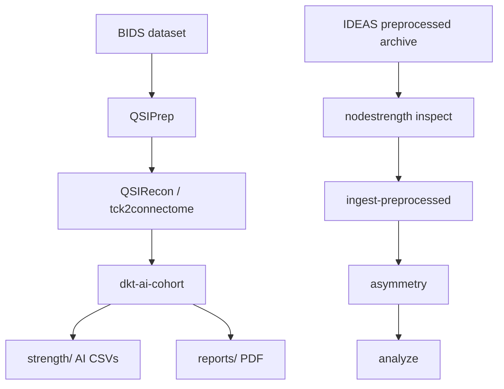

# Running nodestrength

Two entry points cover the common labs:

1. **`dkt-ai-cohort`** — a folder of per-subject DK/DKT connectomes (QSIRecon / MRtrix `fs_default`)
2. **`nodestrength`** — subcommands for inspect / ingest / asymmetry / GLM / single-subject recon

This page is the analogue of QSIPrep’s “Running” guide. Flags: [CLI](cli.md).

## Cohort of DK connectomes

Layout under `--root` (any folder names; BIDS `sub-XXX` is fine):

```
connectomes/
  sub-001/dkt_connectome.csv
  sub-001/dk_nodes.mif          # optional; volume AI
  sub-002/dkt_connectome.csv
```

```bash
dkt-ai-cohort \
    --root /path/to/connectomes \
    --out  /path/to/node_strength_results \
    --with-volume-ai
```

Reports (PDF + figures) are **on by default**. Skip them with `--no-report`. Pass `--participants` if you have SOZ side, group, age, sex, motion.

| Flag | Effect |
|---|---|
| `--with-volume-ai` | ROI volumes from `dk_nodes.mif` and volume AI |
| `--fs-root` | Look for `dk_nodes.mif` under FreeSurfer `SUBJECTS_DIR` |
| `--no-report` | Skip `reports/` |
| `--participants` | Clinical covariates + SOZ-aligned AI / z-scores |
| `--include sub-001 sub-002` | Subset |

## Inspect an archive before ingesting

```bash
nodestrength inspect /path/to/ideas_ii
nodestrength inspect /path/to/ideas_ii --json inspect.json
```

Use this when a Figshare dump or lab `networks/` tree is unfamiliar. Do not run GLM until the verdict is `READY`.

## Ingest then score asymmetry (IDEAS-style)

```bash
nodestrength ingest-preprocessed \
    --archive /path/to/ideas_ii_processed \
    --participants /path/to/participants.tsv \
    --out cohort.csv

nodestrength asymmetry --cohort cohort.csv --out ai.csv

nodestrength analyze --cohort cohort.csv \
    --within nucleus side --between group \
    --value strength --out glm.csv
```

`ingest-ideas` walks **raw BIDS** instead of a pre-processed archive.

## Single-subject reconstruction

Only if you want this package to drive FreeSurfer/THOMAS/MRtrix3 itself:

```bash
nodestrength run-subject sub-001 \
    --t1  /data/sub-001_T1w.nii.gz \
    --dwi /data/sub-001_dwi.nii.gz \
    --bvec /data/sub-001_dwi.bvec \
    --bval /data/sub-001_dwi.bval \
    --rpe-b0 /data/sub-001_acq-rev_dwi.nii.gz \
    --subjects-dir /data/freesurfer \
    --out-dir /data/derivatives/sub-001
```

If QSIPrep + QSIRecon already wrote `dkt_connectome.csv`, skip this and use `dkt-ai-cohort`.

## Strength from a named connectome + LUT

```bash
nodestrength compute-strength \
    --subject-id sub-001 \
    --connectome connectome.csv \
    --lookup nodes.csv \
    --labels merged_labels.nii.gz \
    --out sub-001_strength.csv
```

## Typical lab flow


